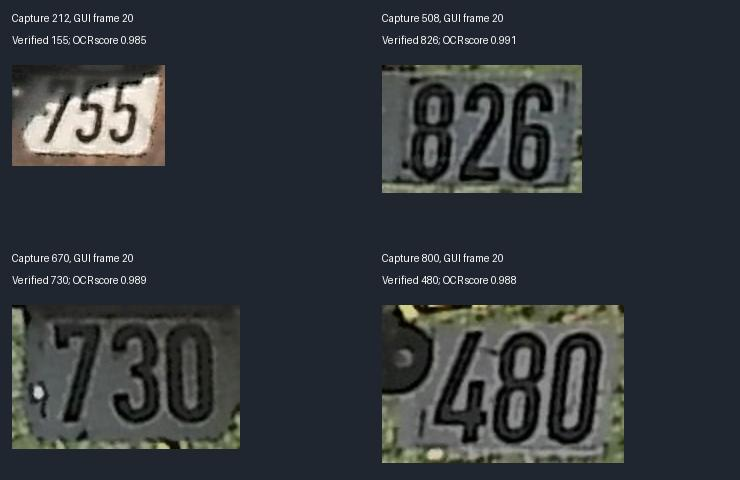
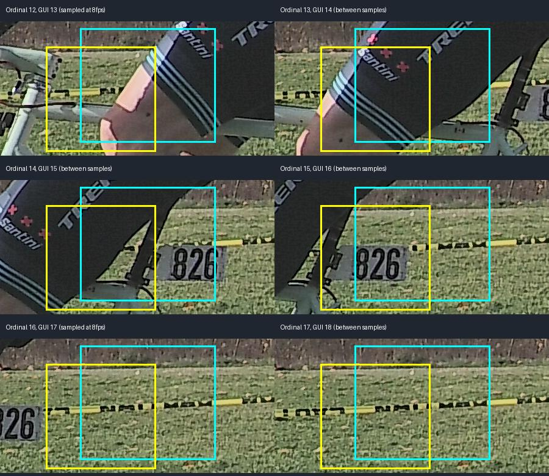

# November 8 cyclocross footage: OCR investigation

Analysis on November 9, 2026. This is an offline investigation; no race results,
accepted bib associations, camera settings, or running GUI configuration were changed.

## Data and preservation

A consistent SQLite online backup was made on zbook9, rather than copying a
potentially active database and omitting its WAL. The source remains intact.

- Snapshot: `data/imports/zbook9/2026-11-09/racevideo-20261109.sqlite3`.
- Size: 175,081,676,800 bytes (about 163 GiB).
- Source snapshot `PRAGMA quick_check`: `ok`.
- Source SHA256: `46818cab16a6edeef2ced6d000bc9485a6dcd1eb9f315bf15fb729d85bf44140`.
- Local transfer verification: **passed**. The full SHA256 matches, all 97,535
  stored frames match declared totals, and daily counts match the laptop. See the
  [verification record](docs/evidence/field-2026-11-08/verified-local.json).
- November 8: 786 clips, 90,679 frames. The complete backup also contains November
  5 and 7: 877 clips and 97,535 frames in total.
- A separately exported, checked working sample contains 14 complete clips and
  1,784 original JPEG frames: `data/imports/zbook9/2026-11-09/field-sample.sqlite3`.
- Experiments read SQLite with `mode=ro`. Their results and crops are separate files.

All times below refer to original stored frame timestamps. OCR processing time
is separate. A visible-plate timestamp is not yet a calibrated finish-line crossing.

## Findings

The images contain usable plate detail. The first reproducible automatic successes
are below. These were detected in a broad search region, without supplying target
numbers or manually cropped plate images to the detector. They are selected
diagnostic successes, not a measured race-wide accuracy or recall score.

| Capture | GUI frame | Verified number | Neural OCR score | Method |
|---|---:|---|---:|---|
| 212 | 20 | 155 | .985 | Native-resolution overlapping tiles |
| 508 | 20 | 826 | .991 | Native-resolution overlapping tiles |
| 670 | 20 | 730 | .989 | Tiles, rotated text detector and recognition |
| 800 | 20 | 480 | .988 | Native-resolution overlapping tiles |



The [example manifest](docs/evidence/field-2026-11-08/verified-examples.json) records
source JPEG hashes, original frame ordinals, timestamps, quadrilaterals, and scores.
GUI frame numbers are one-based; database ordinals are zero-based.

### Why the existing pipeline failed

1. **The narrow OCR area and 8 fps sampling can miss the whole plate.** In capture
   508, the actual production sampler selected ordinals 0, 4, 8, 12, 16, etc.
   The complete plate fits inside the saved narrow OCR boxes at ordinal 15,
   between sampled frames. At 12 and 16 it lies outside them. This is a concrete
   sampling/area failure, even though useful source frames exist.
2. **The old proposal ranking and limit discard useful regions in a broad area.**
   On the selected native frames, a diagnostic run of the existing detector with
   its limit raised to 100 found the 826 region at rank 53 and the 480 region at
   rank 22. The default limit is 20. The vertical 730 region was not proposed.
   These rankings are for the broad test region, not a reproduction of the narrow
   field ROI jobs.
3. **Finding the crop and recognizing it are separate problems.** Giving Tesseract
   the neural detector's crop produced 826 at confidence 76, 730 at 61, and 480
   at 69; it still failed on the selected 155 crop. Thus changing only the text
   recognizer, or only its threshold, does not solve all the failures.
4. **Shrinking the entire search band loses small characters.** The experimental
   neural detector defaults to a long-side limit of 960. At that size it missed
   826 and 480 in these diagnostic views. Larger inputs or native-resolution
   regions recover them. A tighter ROI does not currently magnify the production
   MSER detector: its scale is based on full-frame dimensions.
5. **The initial tracking gate was too small for race motion.** Plates move roughly
   140 source pixels between some frames while their text box is only about 100
   pixels wide. A tracker initialized with zero velocity and a .9-box-diagonal
   gate splits these tracks before it can estimate velocity. The new diagnostic
   summarizer allows a 2.5-diagonal initial step, then uses the original tighter
   prediction gate. The library default is unchanged.
6. **Best-frame selection is not yet reliable on arbitrary detected text.** Generic
   text tracks include tape, logos, background print, and fragmented plate crops.
   Recognizing only their five sharpest crops can omit readable plate views.



The field database contains 17 completed November 8 OCR jobs. Sixteen recorded zero
observations. The remaining job, on capture 459, recorded a single-frame candidate
821; it is not evidence of a confirmed successful passing. Existing stored jobs
used `mser-components-tesseract-v4`, not the standalone neural experiment.

### Orientation and confidence

Rotations are necessary, but they produce convincing alternatives:

- 826 can produce 978 when inverted, repeatedly above .9 neural confidence.
- 480 can produce 087 when inverted, sometimes with higher confidence than 480.
- Different views of 155 can produce 755 at high confidence.

One number per frame cannot be chosen simply by its largest OCR score. Variants,
rotations, overlapping crops, and different processing methods are correlated
observations, not extra riders or independent votes. The diagnostic summarizer
retains alternatives and marks repeated competing values ambiguous. An event's
start list, expected lap sequence and independent RFID evidence may help, but do
not establish the answer when both candidates are valid entrants.

## A more useful baseline

A small generic person/bicycle detector first finds the rider region. Text
location and recognition then use the original pixels from that region, rather
than reducing the whole 4K scene or scanning every background tile.

The baseline uses PicoDet-S followed by PP-OCRv5 mobile detection and recognition.
PicoDet-S is an existing general detector, not a model trained on these test plates;
see the [official model/API documentation](https://paddlepaddle.github.io/PaddleX/main/en/module_usage/tutorials/cv_modules/object_detection.html).
No expected bib list enters detection, recognition, or geometric association.

Complete-clip GPU tests on the four initial diagnostic clips produced:

| Capture | Moving encounter | Repeated readings at score >= .85 | Review status |
|---|---|---|---|
| 212 | ordinals 13–25 | 155: 4 frames; 755: 5 | Ambiguous |
| 508 | ordinals 9–34 | 826: 24; 978: 23 | Ambiguous |
| 670 | ordinals 11–19 | 730: 6 | Repeated candidate |
| 800 | ordinals 13–31 | 480: 17; 087: 19 | Ambiguous |

Association uses geometry, not the recognized number. Stationary candidates and
tracks shorter than three source frames are excluded from this summary. Each
encounter remains review evidence, not a confirmed race read. These tests have not
validated crowded groups, identity switches, cross-clip association, or race-wide
false-positive/recall rates.

The four clips took about 4.2–7.4 seconds each for rider detection, text detection,
and recognition on zbook9's RTX A1000. Those figures exclude JPEG decode, file
output, import/model loading, and queuing. The exhaustive tiled/best-view alternative
took roughly 45–52 seconds per clip and still selected poor views. It is useful as
a diagnostic fallback, not the preferred continuous baseline.

A separate scan of **23 other clips / 2,946 frames** across the day completed in
**284.8 seconds wall time and 279.6 seconds CPU time**, with affinity restricted to
logical CPUs 0 and 1 on zbook9. Peak host RSS was approximately 2.05 GiB. This is
about one logical CPU busy on average, plus the A1000; GPU memory was observed at
about 1.1 GiB during the scan. The normal services remained running, but this was
not a full race-day GUI/capture load test.

These totals include source reads, full JPEG decoding and diagnostic output;
individual inference-stage sums account for 179.6 seconds. Across these clips the
inference-stage median was 5.7 seconds; the busiest tested group segment, capture
412, contained 7.9 seconds of video and took 36.5 seconds for those stages alone.
The full-frame scan is therefore **not continuously real-time at 30 fps**, and a
10–30 second latency ceiling is not established for busy groups. Empty tails are
cheap for inference but currently still incur full JPEG decoding. Reduced-image
rider detection before native decoding is a worthwhile next algorithm change.

The broader scan generated 20 moving candidate tracks with a three-frame OCR gap
limit, or 19 when an eight-frame gap and native-frame exit prediction were used.
Those are **not rider counts or an accuracy score**. Visually checked crops include
803, 827, 821, 818, 217, 763, 210, 200, 201 and 422, in addition to the initial tests.
See the [scan summary](docs/evidence/field-2026-11-08/broader-scan-summary.json) and
[crop sheets](docs/evidence/field-2026-11-08/broader-scan-candidates-1.jpg).

Manual review exposed two association issues:

- Capture 412's nearby plates **838 and 826 are merged into one geometry track**.
  Original frames 20 and 24 show both plates; these are separate riders, not merely
  alternative character readings. Its ambiguous status prevents a silent choice,
  but does not recover two passings. Crowded groups need stronger association and
  explicit occlusion handling.
- Capture 562's **200 traversal splits after five frames without qualifying OCR**.
  Allowing an eight-frame gap while closing predicted full-frame exits joins that
  trajectory. This is a diagnostic setting, not validation of all gaps or returns.

All reviewed field clips are 3840×2160. The summarizer accepts explicit native
image bounds so a predicted full exit can close a track before the same number
returns. Its tests cover that distinction; physical race-wide validation remains
outstanding.

A CPU-only full-clip test on whiskey (capture 508, 90 frames), pinned to two
logical CPUs with oneDNN enabled, took **36.0 seconds wall / 69.1 CPU seconds**.
It recovered 826 on 24 frames and retained the inverted alternative. Repeating
seven selected inputs, with detection and recognition interleaved, gave identical
readings on both passes. The `--mkldnn` option is available for further CPU tests;
this limited check is not proof of all-shape/backend determinism. The same 90-frame clip took **11.9 seconds wall / 11.6 CPU seconds** on
zbook9 with the A1000 and the same two-logical-CPU affinity limit, including model
initialization, reads, JPEG decoding and diagnostic output. This is a measured
single-clip result, not a queue-latency guarantee. The GPU remains the more practical
baseline for the desired latency.

Topology check: on both hosts, logical CPUs **0 and 1 are SMT siblings on one
physical P-core**. A second whiskey CPU test using logical CPUs **0 and 2**, on two
distinct physical P-cores, took **24.2 seconds wall / 46.7 CPU seconds**. It recovered
826 on 24 frames with the inverted alternative retained. This meets the 30-second
end of the proposed budget for this one clip on the desktop, not a guaranteed
latency for crowded groups or the laptop's CPU. Future affinity settings should
use the actual CPU topology rather than assuming adjacent logical IDs are separate
cores.

## Capture health and timestamp interpretation

The full race-day metadata reports zero `capture_bad_packets_in_segment` in all
786 clips and zero cumulative `analysis_overrun_frames` in every clip. All clips
have these fields. This supports separating the observed OCR failures from those
recorded capture/analysis failure counters; it does not prove that no camera frame
was lost before host ingestion. See [capture health](docs/evidence/field-2026-11-08/capture-health.json).

The footage spans approximately **10:15–15:27 at UTC−7**, with 2,997.7 seconds of
saved segments over a 5.2-hour span. Whiskey's installed tzdata is 2026b and resolves
America/Vancouver as UTC−8 for this date; zbook9 uses 2026e and resolves it as UTC−7.
The latter agrees with [BC's current permanent Pacific time rules](https://www2.gov.bc.ca/gov/content/governments/celebrating-british-columbia/daylight-saving-time).
Stored nanosecond UTC timestamps were not shifted. The inventory's explicit local
bounds use a copied laptop TZif file; both hosts produce the same daily clip counts.
No system timezone or package settings were changed. Laptop NTP currently reports
unsynchronized, so independent race-clock/reader alignment still needs validation.

## Image settings and hardware

The working sample confirms that settings changed during the day: early captures
110/160 recorded exposure values 40/43 (4.0/4.3 ms); 212 recorded 8 (.8 ms); captures
400 onward in the sample recorded 4 (.4 ms, about 1/2500 s). Gain was 190 in these
samples. Manual focus/iris changes are not captured by these controls.

Later images have readable detail but also substantial texture/noise and sharpening.
The four successful reads show that the camera data is not universally unusable.
They do not establish optimal camera settings or performance across the entire day.

Whiskey has an i7-14700K, 128 GB RAM, an RX 6800 XT and a second Navi23-class AMD
GPU. The installed ONNX Runtime exposes CPU/Azure providers. ROCm currently cannot
access `/dev/kfd` as this user; the user is not in the render group. No driver,
group-membership, or camera changes were made. CPU experiments use a separate
Python 3.12 environment; the normal application environment is preserved.

The A1000 tests use zbook9's existing working Paddle GPU environment. Its running
RaceVideo/CrossMgr MCP services were not restarted or changed. Analysis code was
staged separately under `~/racevideo/data/analysis-20261109/code`.

## Tools and reproduction

- `tools/snapshot_recording_store.py`: consistent backup, integrity check and SHA256.
- `tools/verify_recording_snapshot.py`: verify every transferred byte and stored counts.
- `tools/export_review_subset.py`: export complete clips to a derived test store.
- `tools/field_ocr_probe.py`: compare search strategies and save source-coordinate OCR evidence.
- `tools/summarize_field_candidates.py`: group moving numeric proposals and retain conflicts.
- `tools/best_frame_ocr.py`: existing prototype extended with CPU/local-model, resolution,
  tiling and orientation options; original defaults are preserved.

Example using the already installed isolated CPU environment:

```sh
taskset -c 0,2 .venv-ocr-cpu/bin/python -m tools.field_ocr_probe \
  data/imports/zbook9/2026-11-09/field-sample.sqlite3 \
  --models data/imports/zbook9/2026-11-09/models \
  --device cpu --cpu-affinity-count 2 --mkldnn --clips 508 \
  --methods riders960 --detector-rotations 0 90 --try-rotations \
  --output data/ocr/new-field-run

.venv/bin/python -m tools.summarize_field_candidates \
  data/ocr/new-field-run/results.json \
  --output data/ocr/new-field-run/encounters.json
```

Use a new output directory per probe run. CPUs 0 and 2 are distinct physical
P-cores on the two inspected hosts; inspect `lscpu -p=CPU,CORE,SOCKET` before
reusing those IDs on another system. Initial use of the rider method downloads
PicoDet-S from Paddle's official model repository; images remain local. CPU versions:
PaddlePaddle 3.2.2, PaddleOCR 3.3.2, PaddleX 3.3.13. Exact CPU requirements are in
`tools/requirements-field-ocr-cpu.txt`. The laptop uses PaddlePaddle GPU 3.2.2 with
the same OCR/PaddleX versions and its original pretrained mobile recognizer, not
the synthetic DIN fine-tune. Environment records are retained with the evidence.

## Next implementation priorities

1. Keep motion-trigger and OCR search areas separate. A narrow finish trigger must
   not restrict plate recognition to one easily skipped instant.
2. Continue the rider-region baseline on a labeled set of real race encounters,
   including empty clips, obscured plates, groups, distant riders and poor light.
   Split evaluation by encounter/race, not neighboring frames from the same passing.
3. Improve plate localization/association before more font-only recognizer training.
   Add real plate annotations; background text is a major source of wasted work.
4. Use cheap per-frame rider/plate tracking, retain several good native views, and
   run expensive recognition asynchronously. Measure the full queue and decode path,
   not only inference. Keep live GUI updates independent and bound every queue.
5. Preserve orientation alternatives, event-scoped bib lists, original timestamps,
   source crops and encounter identifiers when connecting review candidates to an
   agent or CrossMgr. Returning riders after exiting form new encounters.

The production OCR backend has not been switched. This evidence supports pursuing
this approach; it does not support automatic acceptance of OCR passings yet.

Validation: 66 automated tests passed, including WAL-inclusive snapshots, source
coordinate rotations, fast initial motion, conflicting reads, stationary print,
short occlusion gaps, and exit/re-entry as separate encounters. These tests do not
replace the real crowded-group association checks above.
## November 9 operator review: legacy small frameplates

The operator identified clip **727 as bib 15** and clip **747 as bib 5**. Saved
images were inspected: clip 727 ordinal 24 (displayed frame 25) shows 15 on a
folded back bib and the smaller seatpost plate; clip 747 ordinal 21 (displayed
frame 22) shows 5 on the seatpost plate. Both latest completed 1–3 digit OCR runs
have zero retained observations. These are useful real-video missed-read examples,
not evidence that short-number support alone fixes the detector/recognizer.

The operator reports these are older frameplate labels about **60% of the current
size**. This is a physical-size estimate supplied by the operator, not an image
measurement. Evaluation/training should include legacy small plates, single- and
two-digit labels, and readable body bibs when the frameplate is weak. Lower pixel
count, digit/plate proportions, detection scale and encounter filtering all need
evaluation; no specific root cause or model improvement is established here.

Raw-read inspection narrows the next investigation: clip 747's all-frame GPU run
1487 contains **9 raw `5` readings across 7 source frames** (ordinals 12–30), but
zero retained encounters/observations. Thus some recognition exists and encounter
association/qualification needs inspection before assuming a recognizer-only
failure. Raw alternatives include 3, 0 and 9; the `5` boxes still need positional
validation against the actual plate. Clip 727's latest completed CPU run 1618 has
one raw `15` on ordinal 25, again with no retained observation. Those counts are
raw candidates, not validated OCR successes or independent passings.

Reference labels and source ordinals are recorded separately in
`data/field-tests/2026-11-08/legacy-label-examples.json`. No model was retrained and
these notes do not automatically create operator-confirmed app reviews.
