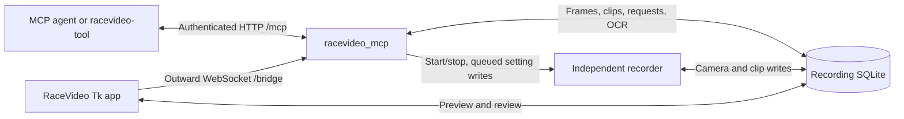

# RaceVideo MCP service

`racevideo_mcp` is a persistent service, independent of the review GUI. It reads
configured SQLite recording stores directly and provides standard MCP Streamable
HTTP at **http://127.0.0.1:8766/mcp**. The app connects outward over WebSocket/TCP
to `/bridge` on the **same port**. The service does not need a display or an open
GUI to inspect saved recordings, export videos, or launch OCR.



Live camera samples now use the latest-frame channel independently of clip
writes. `racevideo.status` exposes capture/analysis backlog metrics;
`app.instances` includes rolling GUI latency measurements. See
[architecture and instrumentation](ARCHITECTURE.md).

## Install and run

From this repository, using Python 3.11+ and Linux:

```sh
.venv/bin/pip install -e '.[ocr,mcp]'
.venv/bin/racevideo-mcp-install-service \
  --db /absolute/path/to/data/racevideo.sqlite3 --enable --start
systemctl --user status racevideo-mcp.service
```

The installer writes absolute paths for this checkout and virtual environment.
A reusable unit template is in [deploy/racevideo-mcp.service](deploy/racevideo-mcp.service).
This is a **user** service: it starts with the user's systemd session. Boot-time
operation without a login requires the host's normal user-lingering setup.

The development installation uses:

- Recording store: `/home/sl/work26/sprinttimer/racevideo/data/racevideo.sqlite3`.
- Unit: `~/.config/systemd/user/racevideo-mcp.service`.
- Service configuration: `~/.config/racevideo-mcp/service.json`.
- MCP bearer token: `~/.config/racevideo-mcp/token` (private, mode 0600).
- Separate app bridge token: `~/.config/racevideo-mcp/bridge-token`.
- App bootstrap descriptor: `~/.config/racevideo-mcp/bridge.json` (private).
- Command/job journal and exports: `~/.local/state/racevideo-mcp/`.

The service starts without opening a camera. Starting/stopping capture is an
explicit operation. Service-started recorders and OCR workers use separate
transient user-systemd units; restarting the MCP service does not stop them.
GUI/CLI-started recorders remain independent detached processes as before.
One recorder per recording database is enforced by an OS lock; do not configure
two stores/recorders for the same physical camera.

```sh
systemctl --user restart racevideo-mcp.service
systemctl --user stop racevideo-mcp.service
journalctl --user -u racevideo-mcp.service -f
systemctl --user list-units 'racevideo-recorder-*'
```

Stopping the MCP service does not mean stopping an independent recorder. Use
`recorder.stop` or the app's Stop recorder control when capture should end.

## Connect an MCP client

Configure a Streamable HTTP MCP endpoint at `http://127.0.0.1:8766/mcp`, sending
`Authorization: Bearer <contents of the private token file>`. Do not paste the
token into source control or logs. The transport uses the
[official MCP Python SDK](https://github.com/modelcontextprotocol/python-sdk),
pinned to the compatible 1.x series in the optional dependency set.

The bundled CLI is a thin authenticated MCP client. It does **not** create a
second service when the first one is down:

```sh
.venv/bin/racevideo-tool list
.venv/bin/racevideo-tool call racevideo.inventory
.venv/bin/racevideo-tool call clips.list --arguments '{"limit":10}'
.venv/bin/racevideo-tool call frames.get \
  --arguments '{"clip_id":109,"ordinal":50}' --output-dir data/agent-images
```

The CLI uses the local configuration/token files. `--url` and `--token-file`
select a different service. Connection startup is retried briefly, but mutations
are never silently retried. The HTTP `/health` endpoint reports only service
liveness without revealing recording data.

Loopback is the default. To expose MCP to another host, configure `--host` and a
`--public-url` origin when installing, keeping bearer authentication. The public
origin is also used for export links and the SDK's allowed-host checks. The app
and recording files are currently expected on the service host; remote agents
can connect over TCP or a forwarded port.

## App bridge

Updated RaceVideo windows automatically read the private bootstrap descriptor,
connect outward and reconnect after service restarts. The toolbar says **MCP
linked** when connected. An absent/unavailable service leaves normal local
capture/review operational. `RACEVIDEO_MCP_BRIDGE_FILE` can select a different
private descriptor for a test or deployment.

Each window registers an instance UUID, PID and canonical database path. Only
configured recording stores are accepted. Multiple windows can be registered;
view commands always require an explicit instance UUID.

A background socket connection is not proof that Tk is responsive. Network
heartbeats carry an independently advancing main-thread tick. Commands are
rejected when GUI progress is stale, expire before delayed execution, and run
on the Tk thread. Camera hardware I/O and image analysis remain outside Tk.
Results arriving after reconnect can reconcile an earlier unknown outcome.

Only registered, updated GUIs participate in edit protection. Reopen older
RaceVideo windows after installing this update and check for **MCP linked**.
An unexpectedly disconnected registered GUI blocks camera changes until its
ownership is reconciled/reconnected or the process exits.

## Tools

| Group | Tools and behavior |
| --- | --- |
| Discovery | `racevideo.inventory`, `racevideo.status`: configured stores, capture freshness, capabilities, current configuration |
| Saved video | `clips.list` (day/bib/star filters), `clips.dates`, `clips.star`, `bibs.sightings`, `clips.info`, `frames.list`, `frames.get`, `clips.contact_sheet`, `clips.export` |
| Camera | `camera.devices`, `camera.controls`, `camera.sample`, `camera.set`, `camera.tune` |
| Recorder | `recorder.start`, `recorder.stop`, `recorder.capture` |
| Configuration | `settings.get`, `settings.set` |
| OCR | `ocr.start`, `ocr.status`: optional independent workers and candidate evidence |
| GUI | `app.instances`, `app.control`: live/review/frame navigation and playback |
| Outcomes | `commands.get`, `jobs.get`, `jobs.cancel`, `jobs.frame` |

All recording operations select a configured `store` (default `default`). They
do not accept arbitrary file paths from an agent. Additional named stores can
be configured in `service.json` or with repeated server `--db NAME=PATH` flags.
Recording databases must be distinct, canonical files.

Frame ordinals in MCP are **zero based**; the GUI's human labels are one based.
For example, MCP ordinal 50 is the GUI's Frame 51. Host receipt times, source PTS
and monotonic intervals are retained separately; none are calibrated finish times.

### Viewing saved video without the app

`frames.get` and `clips.contact_sheet` return actual MCP image content with frame
metadata. A normalized crop and a larger `max_width` let an agent inspect plates
at source resolution. The contact sheet samples actual monotonic frame times.

`clips.export` creates an MP4 derivative in a bounded background job, with one
native encoder thread and original inter-frame timing. Poll `jobs.get`; completed
exports include a five-minute signed download URL, usable by a video viewer
without sharing the full MCP bearer token. HTTP range requests are supported.
Exports are cached under the service state directory; no automatic cache pruning
is implemented yet. Original JPEG frames remain unchanged.

```sh
.venv/bin/racevideo-tool call clips.contact_sheet \
  --arguments '{"clip_id":109,"count":8}' --output-dir data/agent-images
.venv/bin/racevideo-tool call clips.export \
  --arguments '{"clip_id":109,"command_id":"review-109-export"}'
# Pass the returned job id to jobs.get.
```

### Camera control

`camera.sample` requires a fresh frame and rejects stale last-frame images.
`camera.devices` lists stable device aliases and distinguishes capture-capable
nodes from metadata-only nodes, useful when changing cameras.
It returns the image plus brightness, clipping fractions and an edge-energy
proxy. `camera.controls` returns driver-reported ranges, steps, menu entries,
current values and inactive flags. `refresh_if_stopped=true` performs a read-only
device query without starting capture.

Ordered `camera.set` batches can disable automatic exposure before setting the
manual time. Each request is tied to the recorder session, expires before a
delayed execution, and returns actual driver readback. The recorder must advertise
control protocol 3; restart an older recorder before using these operations.

```sh
.venv/bin/racevideo-tool call camera.set --arguments \
  '{"changes":[{"id":10094849,"value":1},{"id":10094850,"value":218}],"command_id":"manual-exposure-01"}'
```

Those IDs are V4L2 exposure mode and exposure time, respectively; 218 is nominally
21.8ms. Discover the camera's actual support before writing. The service does not
assume that a reported zoom is optical or that a lens has motorized focus.

Before a change, all registered responsive GUIs reserve the requested controls.
Unsaved operator drafts or pending edits reject the request. Reserved fields are
disabled while still showing readback. **Release agent control** takes control
back immediately; the same agent lease cannot reacquire or restore over that
operator action. Revocation is also persisted in SQLite and checked by the recorder
before each queued agent write; batches enqueue atomically. GUI-side reservations
alone do not authorize a late write after takeover. Reservations expire if the service stops renewing them.

### Bounded tuning

`camera.tune` starts an asynchronous exposure/gain experiment. Its first version
does not automatically sweep focus, contrast or sharpness; an agent can adjust
those through `camera.set` while inspecting samples.

```sh
.venv/bin/racevideo-tool call camera.tune --arguments \
  '{"exposures":[80,160,218],"max_gain":128,"min_median":40,"use_ocr":true,"valid_numbers":["235","469"],"apply_best":false,"command_id":"wheel-trial-01"}'
```

The job performs at most six trials, waits for settings to take effect, saves two
fresh source frames per trial and records the requested settings/readback, image
metrics and optional OCR results. The human visibility floor applies to the
**whole preview**, even when a crop is supplied for OCR. Defaults require median
gray level at least 40 and highlight clipping no more than 15%.

Among visibility-qualified trials, stable sampled OCR is preferred when present;
then the shortest exposure wins, with lower gain breaking ties. Without usable
OCR it falls back to visibility proxies and explicitly says so. Optional valid
numbers constrain OCR candidates; they do not turn confidence into a calibrated
probability. Static samples cannot establish high-speed motion readability.

`apply_best=true` keeps the selected settings after confirmed writes. With
`apply_best=false`, no qualifying trial, cancellation or a trial error, starting
settings are restored **if the same recorder/session and operator reservation
still permit it**. An operator takeover, a changed session or uncertain write
outcome prevents a blind restoration; the job reports that boundary explicitly.
`jobs.frame` returns a retained trial image, and `jobs.cancel` requests cancellation.

The one-heavy-job queue keeps export/tuning work bounded. OCR remains its own
bounded worker. Profile the combination on the actual race laptop before treating
this as a validated two-core race workload.

### Recorder/settings and GUI operations

`recorder.start` can start capture headlessly, using the most recent configuration
plus explicit overrides. `recorder.stop` and `recorder.capture` return queue
acceptance; poll status or the clip list to confirm the resulting state.

`settings.set` applies `motion_roi` and `ocr_area` live. Resolution, requested fps,
motion sensitivity and timing parameters are validated recorder configuration;
they return `requires_restart` unless the caller supplies `restart=true`. A
restart flushes the current event and creates a new recorder session. Existing
saved review remains available. The first implementation does not enumerate
every supported camera video mode; an unsupported mode produces a capture error.

`app.control` supports `view.live`, `view.clip`, `view.frame`, `playback.play` and
`playback.pause`. View requests wait for the requested frame to reach the GUI,
rather than merely acknowledging that a command was queued.

### Command outcomes

Supply a stable `command_id` for a mutation. Repeating the same ID and arguments
returns the original outcome; changing arguments under the same ID is rejected.
Queued jobs also return their `command_id` separately from the job ID.

`unknown` means the reply was lost or timed out, **not** that the action failed.
Use `commands.get` and current device/view status to reconcile. Do not generate
a fresh ID and blindly replay capture, restarts or camera changes. GUI results
can arrive after reconnect and update the journal. Camera request IDs/readback
remain in the recording database as additional evidence.

## Validation

```sh
.venv/bin/python -m unittest discover -s tests -v
xvfb-run -a .venv/bin/python tests/mcp_integration.py
# Requires the physical webcam to be free; touched settings are restored:
xvfb-run -a .venv/bin/python tests/mcp_live_smoke.py
```

Verified here: authenticated MCP requests; offline images/contact sheets/MP4
export and signed/range downloads; real Tk reverse connection and view/playback;
main-thread stall rejection; duplicate/unknown outcome handling; service restart
and app reconnect; device readback and expired requests; operator draft protection;
measured camera trials, restoration and operator takeover; independent transient
recorders surviving the installed service's restart. See
[deployment evidence](docs/evidence/mcp-service-validation.json).

This is local Linux/C615 validation. It is not a field-race, 4K load, calibrated
exposure, or OCR-accuracy acceptance test. CrossMgr integration and race writes
remain outside this service.

## Daily review

See [REVIEW.md](REVIEW.md) for local-day grouping, candidate bib filtering, stars,
source navigation and confirmed GUI cleanup. `clips.list` omits the date by
default to preserve all-date API pagination. GUI review starts on Today.
`clips.star` is a persistent idempotent command; use `commands.get` to reconcile
unknown outcomes. No remote deletion tool is exposed.

Bib filtering uses the indexed many-to-many `video_tag_matches` lookup.
`clips.info` includes `tag_matches`, with multiple rows when a segment contains
multiple candidate riders. Detailed sightings remain independently accessible.
See [SQL examples](SQL_MATCHES.md).
