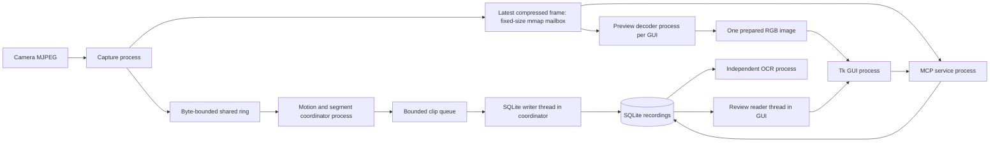

# Process boundaries and responsiveness

Implemented 2026-11-04. Standard CPython; no free-threaded interpreter required.

## Capture and delayed analysis

The camera process performs V4L2/PyAV packet ingestion, timestamps the packet,
and copies original JPEG bytes into shared memory. It does no decoding, motion
analysis, SQLite work or Tk work. Capture therefore continues while analysis is
busy. Spawned processes do not inherit GUI, database or decoder state.

The compressed ring has a `--buffer-mb` byte budget (default 64 MiB) and 8,192
metadata slots. Its duration depends on measured camera bitrate, not nominal FPS.
Consumers copy small batches under a short lock; no decoding runs under that lock.
A stalled/dead lock owner causes a reported failure rather than an indefinite wait.

The coordinator consumes frames in order and samples motion using their original
monotonic receipt timestamps. A delayed detector still assembles the appropriate
0.5-second pre-roll and 2-second post-roll. It does not replace timestamps with
analysis completion time. Saved frames remain original compressed JPEGs.

If analysis falls beyond retained history, capture continues. The coordinator
counts overwritten frames, closes the current segment with
`end_reason=analysis_overrun`, resets its comparison baseline/history, and resumes
from available frames. The GUI reports **ANALYSIS GAP**; the MCP status and clip
metadata expose the loss. This is incomplete footage, not an inferred continuous
segment. Increase the byte budget or reduce analysis work after measuring bitrate
and lag. Changing the buffer budget requires restarting the recorder.

Memory is bounded by the shared ring, coordinator recent-history buffer (also
`--buffer-mb`), active motion chunk, three queued clips, one clip being written,
and small fixed IPC buffers. Event limits are configurable; a limit is checked
after adding a frame, so a chunk can exceed its byte threshold by a frame or its
initial pre-roll. These are pipeline bounds, not a total process-RSS guarantee.
Disk retention is still an explicit future feature.

The writer thread owns SQLite transactions, thumbnails and camera control I/O.
A slow disk can delay saved-clip availability/control readback; it cannot block
the camera or the GUI's live image channel. A full clip queue reports skipped
clips. OCR remains a separate process working on committed segments.

## Latest-only preview

Capture publishes at most 20 compressed previews/second to a fixed 16 MiB mmap
mailbox beside the database (`*.sqlite3.preview`, mode 0600). It overwrites the
same mapped pages, without a per-frame file creation, SQL transaction or fsync.
A nonblocking file lock protects each copy; publication can be skipped rather
than waiting for a reader. The mailbox is ephemeral preview data, not a recording.
Restarting capture atomically replaces it; readers detect the inode change.

Each GUI starts a separate preview process. It independently reads the latest
JPEG, decodes/resizes for the actual canvas, and publishes into a one-image
shared-memory slot. Intermediate prepared images are superseded. GUI reads use a nonblocking lock;
a stalled or failed decoder cannot leave Tk blocked on a partial pipe transfer. Transfer dimensions
are capped at 1920x1080; full-resolution source/saved frames remain available.
The scheduled rate is a ceiling, not a promised FPS. A slow decoder delivers fewer
fresh images rather than accumulating an old video stream.

Tk polls approximately every 30 ms. It updates one retained canvas image and
existing overlays, with image decoding outside the GUI process. Tk image creation
and presentation still happen on its main thread. Other event delivery is capped
and time-budgeted; status coalesces and thumbnails load in batches. The review
reader remains independent of live preview. Legacy SQLite-only stores provide a
fallback last image. Review transport uses original source timing.

A closed GUI stops its preview worker but leaves recording running. Preview and
capture workers also check parent liveness. Recorder shutdown stops/joins its
camera child; the MCP service and its independently supervised recorder retain
their existing separation.

## Instrumentation

Open **Performance…**, or inspect `gui_metrics` in MCP `app.instances`.
GUI distributions retain only 300 samples per metric, with last/median/p95/max:

- `callback_delay_ms`: callback lateness relative to its scheduled deadline.
- `callback_work_ms`: actual work performed inside the callback.
- `preview_decode_ms`: JPEG decoding, resizing and RGB preparation in the worker.
- `preview_handoff_ms`: preparation-to-GUI handoff, including IPC/polling.
- `tk_image_submit_ms`: image creation/submission and overlay updates.
- `preview_age_ms`: host camera receipt to Tk submission of that image.
- `preview_interval_ms`: intervals between live image submissions.
- Counters: images produced/presented/superseded, worker PID and liveness.

These measure submission, not physical monitor scanout or camera exposure time.
An unchanged/stopped camera supplies no new samples; use recorder freshness and
worker liveness alongside the distributions. `preview_current_age_ms` keeps
advancing even without new samples; a stale live preview gets an on-screen warning.

MCP `racevideo.status` and the performance window expose capture/analysis PIDs,
ring bytes/duration, capture/processed frame counts, backlog, analysis lag,
overrun count, latest motion-analysis duration, writer queue depth and latest clip
write duration. Agent live samples use the latest JPEG channel independently of
clip writes; camera changes still require verified control readback.

## Validation and limits

- 39 unit checks, including byte wraparound, metadata bounds, independent cursors,
  explicit overwrite counts, fixed-size/private preview mailbox and bounded metrics.
- Deterministic real-recorder test verifies original timestamps, pre/post-roll,
  motion thumbnail selection and SQLite integrity with the spawned capture process.
- Real Tk/MCP tests cover review/playback, reconnects, draft protection and operator
  takeover; physical Logitech C615 tests cover live samples and setting readback.
- `tests/pipeline_stress.py`: synthetic full-HD 30fps packets, 180ms added to each
  motion analysis, active resize/navigation and one intentional 600ms GUI stall.
  Measurements: [normal backlog](docs/evidence/pipeline-stress.json) and
  [forced ring overwrite](docs/evidence/pipeline-overrun.json).

The normal-backlog run kept preview fresh with analysis roughly five seconds
behind. The overwrite run verifies bounded memory and visible/recoverable loss.
These are developer-host synthetic measurements, not a 4K camera, laptop CPU-budget,
long-event storage or race-speed OCR qualification. Next measurements should use
the ordered camera and target laptop under sustained capture/OCR/review load.

## Daily review

The review browser polls date/bib/star metadata separately and loads thumbnails
in small generation-tagged batches. Old filter results are discarded. Original
frame crop/zoom rendering runs in the review reader; live preview remains in its
independent process. Captions follow displayed frames, not pending playback
requests. Schema v7 adds persistent stars and a durable clip-ID high-water mark;
cleanup checks the recorder's storage protocol before permitting deletion. See
[the operator guide](REVIEW.md) for evidence/retention semantics.

Schema v8 adds a persistent many-to-many bib/video match table and today's-match
view. SQLite triggers publish the latest completed OCR match set atomically;
observations keep per-encounter detail and older-run history. GUI/API bib filters
use the indexed lookup and return each shared clip once.

Worker cancellation/completion uses monotonic shared-memory flags. In particular,
GUI shutdown does not acquire a multiprocessing Event/Condition that a terminated
preview child could leave locked. This crash case was exposed and verified on the
Python 3.14 zbook9 deployment; see [laptop validation](ZBOOK9.md).

Camera packets now receive structural JPEG/FFmpeg corruption checks before entering
the ring. Isolated damaged packets increment `capture_bad_packets` without stopping
capture; 60 consecutive damaged packets or a two-second bad-packet streak fails
visibly. Segment metadata summarizes lost packets inside its receipt-time extent.
See [ELP camera validation](ELP_CAMERA.md) for physical evidence and limitations.
