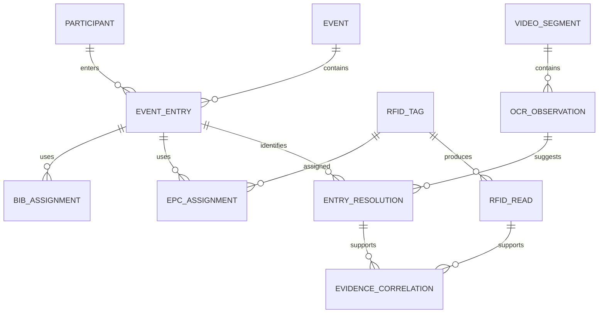

# Event identity and OCR/RFID evidence integration

Design notes, 2026-11-04. These are future integration requirements, not implemented
CrossMgr/RaceDB/Impinj connectors or changes to race results. The current schema v8
bib/video lookup is implemented; see [SQL_MATCHES.md](SQL_MATCHES.md).

## Identity belongs to an event entry

A calendar day is a review/storage grouping, not a race identifier. There can be
several cyclocross events on one date, with the same person entered more than once
using different bibs. A participant's name is display/search metadata, not a key.

The intended relationships are:

A stable person might therefore have:

| Event | Person | Bib | Physical tag assignment |
|---|---|---|---|
| Single-speed | Participant A | 123 | EPC A |
| Intermediate | Participant A | 456 | EPC A, or a separately assigned tag |

A later event can assign bib 123 to somebody else. A person query follows their
entries; a bib query must include event context to resolve identity. Day/bib lookup
alone remains useful for retrieving raw candidate videos, but cannot identify the
person unambiguously.

Planned identity records should include:

- Events with durable local IDs and source-qualified external references. Neither
  date, display name nor start time alone is the event key.
- Participants with source-qualified stable IDs where available. Do not merge
  people solely by identical names or assume IDs from different systems coincide.
- Event entries joining event and participant, with upstream entry/category/wave
  references. Start-list snapshots and revision provenance support offline review.
- Bib and EPC assignment history with event scope, effective time/revision and
  source. Support corrections, replacements and multiple authorized tags rather
  than overwriting past evidence.
- Name snapshots sufficient to understand retained/starred evidence after upstream
  start lists change. Keep raw observations and previous identity resolutions.

The current `video_tag_matches.tag_id` means an **OCR bib string**, not an EPC,
participant ID or event-entry ID. Keep this raw match table intact. Add explicit
entry-resolution records later; do not silently reinterpret its existing column.
A clip can contain several riders and can be relevant to multiple events/waves.
Do not require one event per video or resolve overlapping events using date alone.

## EPC representation

Store the reader's original EPC plus a canonical hexadecimal representation and
bit length. Preserve leading zeroes; do not restrict identifiers to a SQL integer
or hard-code every EPC as 96 bits. Keep optional TID information separate.

96-bit encodings exist, but EPC and the tag chip's optional serialized TID have
different roles. The EPC is programmed for the application; it is not the person's
immutable identity. Assignment history also handles a tag being replaced,
reprogrammed, lent or associated with the wrong entry. Source: [GS1 EPC/TID FAQ](https://epcencoder.gs1.org/tools/tagxlate/FAQ.html).

## Independent streams and provenance

Capture and OCR continue without any upstream connection. Future MCP consumers
fetch start lists, event state and RFID evidence asynchronously from CrossMgr,
RaceDB and optionally Impinj services, caching the relevant data locally.

Record at least the original source timestamp, local receipt timestamp, source
system/reader/antenna, upstream record ID, clock-domain information and lineage.
Processing or network delay must not move a read to its arrival time. Calibrate
camera/reader offsets and timing uncertainty before choosing a matching window.
A date/time filter is a convenience, not an event identity decision.

Many repeated antenna reports should resolve into a passage candidate, with the
raw reads retained. Dedupe the same physical read appearing through both Impinj
and CrossMgr; those are not two independent confirmations.

**An OCR-derived provisional read written into CrossMgr must never return through
MCP and count as independent RFID confirmation of itself.** Preserve origin and
parent evidence IDs. Unknown/manual/derived origins do not qualify as physical
RFID corroboration.

## Correlation and operator display

Correlate individual OCR encounters and RFID passage candidates through the same
resolved event entry and a calibrated timestamp window. Matching "some EPC" in a
group segment is insufficient. Preserve one-to-many/ambiguous candidate links
until the start list and evidence can resolve them; do not force a match merely
because it was predicted.

Suggested per-rider/per-encounter indicators:

| Indicator | Evidence meaning |
|---|---|
| OCR + RFID | Compatible OCR and independently sourced physical RFID evidence for the same event entry/window |
| OCR only | OCR candidate with no matching RFID read in a window whose feed coverage has been checked |
| RFID only | RFID passing candidate with no corresponding readable OCR observation |
| Awaiting RFID | RFID stream unavailable, delayed, incomplete or not yet checked through the relevant window |
| Ambiguous / conflict | Bib/event assignment, tag assignment, identity or timing does not support a unique correlation |

Use text/icons as well as colour. A video thumbnail may summarize several riders;
a clip-level green badge must not imply every rider in the clip was corroborated.
Show per-rider status and optionally a summary such as "4 correlated, 1 OCR only".
Badges indicate source agreement, not automatic confirmation of laps, placing or
finish order. Both streams can carry bad assignments or correlated errors.

Allow late evidence to move Awaiting/OCR-only into OCR + RFID while preserving
what changed. RFID ingestion needs feed coverage/watermarks to distinguish a
missing read from a feed that has not caught up. CrossMgr predictions can guide
review, but do not manufacture independent evidence or exclude unexpected riders.

## Proposed implementation sequence

1. Inspect the actual upstream MCP contracts and stable identifiers. Define event,
   entry, participant and assignment references before adding names to OCR rows.
2. Add cached event/start-list snapshots and explicit event selection to day review.
   Provide bib, name, participant and EPC queries through event-entry relationships.
3. Ingest immutable RFID records with durable cursors, idempotent source IDs,
   lineage, reconnect/backfill and clock/coverage metadata.
4. Add a separate correlation worker, stored evidence links and per-rider badges.
   Keep capture/preview independent of synchronization and analysis delays.
5. Validate multiple events/day, same person/different bibs, reused bibs, reassigned
   or erroneous tags, overlapping events, repeated reads, lost reads, delayed feeds,
   clock offsets and prevention of provisional-read feedback loops.
6. Only then add a separately authorized CrossMgr provisional-read workflow with
   explicit provenance, reconciliation and review. No race-result writes are part
   of the current video-match implementation.

## TODO: label orientation and ambiguous bibs

Race labels may be horizontal, vertical or upside down, independently of plate
orientation. Add orientation-aware OCR/tracking across adjacent frames, retaining
the source crop, tested rotation and competing readings. The current recognizer
tries 0/180 degrees by default; vertical-label coverage still needs implementation
and physical validation.

Consult the event-scoped CrossMgr start list, expected passing windows and
independent RFID evidence when ranking alternatives such as 609/906. Both bibs
can be entered in the same race: start-list membership or a prediction alone
cannot settle that ambiguity. Keep unresolved alternatives visible for source
review; do not silently choose one or create a confirmed passing.

The wheel fixture has a separate upright-only test option. Disable it for race
trials where upside-down labels are possible.
